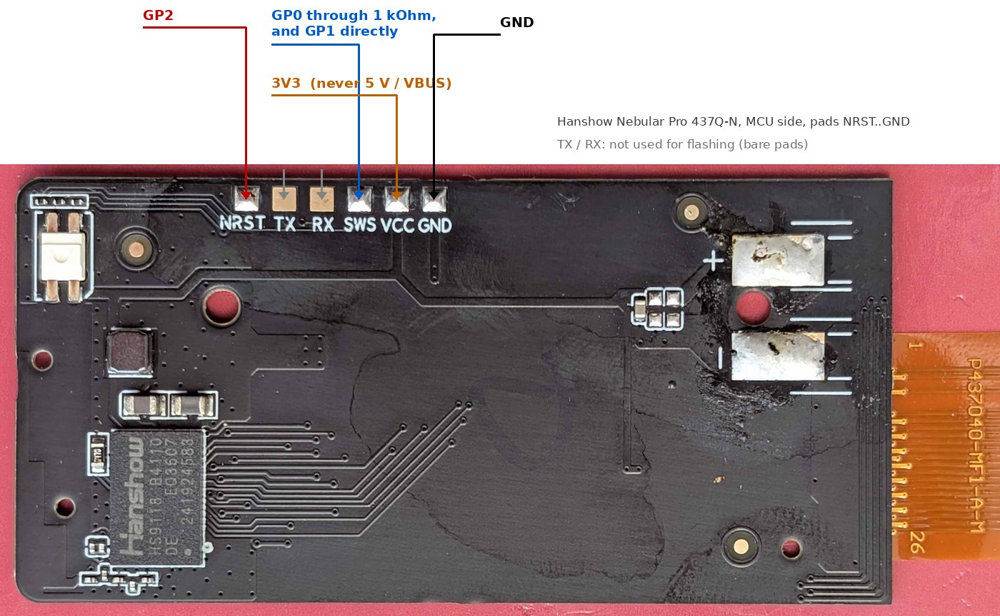

# n437 firmware 0.9f: user guide

Repo path: `steanlab/badge437` (public) → `docs/USER_GUIDE.md`. Russian: `docs/USER_GUIDE.ru.md`. Firmware: `firmware/n437_0.9f.bin`. Page: <https://steanlab.github.io/badge437/>.

Unofficial project. Flashing replaces the original firmware of the tag; do it only if you accept that, at your own risk. Tested on one tag.

**Two stages:** the first installation needs a programmer wire (once, section 1); after that everything, including firmware updates (OTA), is done over Bluetooth from the page. The original firmware cannot be updated over Bluetooth.

## 0. What you need

* **The tag:** Hanshow Nebular Pro 437Q-N (4.37", 176 x 480 four-colour). The marking `HSEL4Q_04_37M_32` is on the board; a different Nebular model has another panel and other pins, this firmware is for the 437Q-N only.
* **A tag whose panel data is intact.** The tag keeps the drive data of its panel in its flash (the "waveform block"). Firmware that was on the tag before can have damaged it (we saw it on 2 of 4 tags that had run ATC_BLE_OEPL-based builds). Section 1 has a check; a damaged tag cannot draw until it is repaired.
* **A programmer** that talks to the Telink single-wire debug interface (SWS) of the tag. Here it is the open **RP2040 bridge by Gerard780** ([github.com/gerard780/hanshow-rp2040-programmer](https://github.com/gerard780/hanshow-rp2040-programmer), MIT licence): a small RP2040 board with the bridge firmware **v1.6**, one **1 kOhm resistor** and five short wires.
  * Recommended board: **Waveshare RP2040-Zero**, with the ready firmware `dist/hanshow_pio_bridge.uf2` from that repository (SHA-256 `55a226a09190eaf8bae327b0671f9c1d1d261f7001a51e233e2f23a95c454a51`). To install it: hold the BOOT button while plugging in USB, copy the file to the drive `RPI-RP2`. This flashes the **programmer**, not the tag.
  * The author used a **Raspberry Pi Pico** with the same firmware source built with other GPIO numbers (a few GPIOs of that particular board were dead). You do not need that; the signals are the same, only the GPIO numbers differ.
* **A computer:** the author used **Ubuntu Linux with Python 3.12.3** (pyserial 3.5). Windows and macOS were not used for this tag. On Ubuntu your user must be allowed to use the serial port: `sudo usermod -aG dialout $USER`, then log out and in again.
* **Wires to the tag:** thin wires soldered to the pads, or spring (pogo) probes held on them. The pads are small and flat.
* **A phone or computer with Chrome or Edge** (Web Bluetooth) for the page afterwards: Android phone (also gives NFC), Windows, macOS, Linux, ChromeOS. **Not** iPhone / iPad, **not** Firefox / Safari.
* About 30 minutes the first time.

### Where the wires go

The programming pads are in one row on the MCU side of the board (the side with the `Hanshow HS9118` module), at the top edge, left to right: `NRST  TX  RX  SWS  VCC  GND`. `TX` and `RX` are not needed for flashing.



| RP2040-Zero (use the printed GPIO numbers, not Pico header pins) | Tag pad |
|---|---|
| `GP0`, **through a 1 kOhm resistor** | `SWS` |
| `GP1`, directly (on the tag side of the resistor) | `SWS` |
| `GP2` | `NRST` |
| `3V3` | `VCC` |
| `GND` | `GND` |
| `GP5` (UART RX), optional | `TX` (only to read the tag's log; not needed) |

These are the numbers of the ready UF2. If you build the bridge firmware yourself with other GPIOs, the roles stay: *SWS drive* through 1 kOhm, *SWS sense* direct, *reset* to `NRST`.

* **Unplug USB while you wire.** The programmer's **3.3 V powers the tag**; the tag has **no battery** connected while you flash. Never feed the tag from the battery and the programmer at once, and **never connect 5 V / `VBUS` to `VCC`**.
* Do not touch the panel's flat cable or its pads.

## 1. Flash it (once)

1. **Keep the original.** The software reads the whole flash of the tag before it writes anything and stores it as a backup file. **Keep that file**: it holds the factory data of your panel (the waveform data the firmware needs, see [HARDWARE.md](HARDWARE.md)), the radio calibration and the factory record of your tag. Never publish it (it contains your tag's address). Read the flash twice and compare the copies if you like.
2. Wire as in section 0, then plug the programmer's USB into the computer.
3. **Software.** The flasher is [`tools/nebular_debug_custom.py`](../tools/nebular_debug_custom.py) by Gerard780 (the author of the bridge), included unchanged, see [`tools/README.md`](../tools/README.md). It already knows the 437Q-N (flash id `EB 60 13`, factory record at `0x7E000`, application zone `0x00000`..`0x1FFFF`), refuses to write if the factory record is not the expected one, writes only the changed sectors of the application zone and puts back the flash protection. Needs Python 3.9 or newer; on Ubuntu (the author used Python 3.12.3):

   ```
   python3 -m venv .venv
   .venv/bin/pip install pyserial pyusb libusb-package
   ```

   Use `.venv/bin/python` instead of `python3` below, from the repository folder. On the first run the script downloads four helper modules from the bridge repository and checks their hashes (Internet needed once). Linux needs permission for the serial ports (`dialout`, section 0) and for USB; if USB access is denied, use the udev rules of the bridge project or run the command with `sudo`. Close other serial programs first. With one bridge connected the ports are found automatically; with several use `--bridge-serial`. The bridge firmware must be v1.4 to v1.6 with reset enabled (the ready UF2 is).
4. The programmer shows up as a USB serial port:

   ```
   python3 tools/nebular_debug_custom.py --model 437 --list-ports
   ```

   The bridge must be in the list. Then the **dry run** (backup and plan only, nothing is written):

   ```
   python3 tools/nebular_debug_custom.py --model 437 --custom-firmware firmware/n437_0.9f.bin --no-questions --seconds 5
   ```

   It must end with `plan_verified` and no error. **Then check the backup it made** (file `before-1.bin` in the new folder `nebular-debug-<date>`):

   ```
   python3 tools/check_waveform.py nebular-debug-*/before-1.bin
   ```

   It must say `waveform block OK`. If it says `BAD`, **do not flash**: see section 8, "Damaged waveform block". It refuses a tag whose flash protection status is not `2C`, or whose factory record it does not recognise: then stop and ask.
5. **Flash:**

   ```
   python3 tools/nebular_debug_custom.py --model 437 --custom-firmware firmware/n437_0.9f.bin --apply --no-questions --seconds 5
   ```

   It must end with `whole_flash_verified` and `protection_restored`. Only the application zone (the first 128 KiB of the flash) is written; the factory data stays untouched.
6. Unplug USB, remove the wires and give the tag power (battery in). The LED shows red, green, blue twice. For the first 4 seconds the firmware erases and formats its data area (that is normal; the panel stays as it was).
7. Check the file before flashing: `sha256sum -c SHA256SUMS.txt` in `firmware/`.

If anything looks wrong, send nothing to the tag and keep the backup; the original firmware can be written back from the backup at address `0x00000` with the same tool (never overwrite `0x78000`..`0x7FFFF`).

**First start with the wizard:** after connecting, the card "First start: step-by-step check" at the top of the page walks through the steps below (connect, firmware version, orientation, first picture, first draw, slideshow) and ticks each one from what the tag reports; "Hide the wizard" hides it (the button "First-start wizard" brings it back).

## 2. First connection (the 120-second window)

The tag starts in **standalone mode**: Bluetooth is on **only for 120 s after power-up** (and for 60 s after every tap, see below). A short **blue flash every 5 seconds** means "the window is open and nobody is connected".

1. Open <https://steanlab.github.io/badge437/> in Chrome / Edge, press "Connect" (the language button switches English / Russian), choose the device `OD-xxxx`.
2. When linked the LED flashes green (a dim green flash every 5 s while linked). The slot card lists the slots and the free space.
3. **Check the orientation:** card "Panel", orientation = *mirrored horizontally* (the default of 0.9d). If your tag stored another value (flashed with 0.9a and never set) pictures come out mirrored: choose it and press "Apply"; it is stored. (Or send `4D 02 17 27` in the developer card.) The colour table field stays `27`.
4. When the window ends the LED flashes red once and the tag goes to sleep. To open a window again: touch the tag with the phone (NFC, 60 s) or cut and restore the power (120 s).

## 3. Put a picture on the tag

Card "New picture":

1. Choose an image file; it is fitted to 176 x 480 pixels (portrait in the preview; use the rotation if your picture is landscape). Options: fill (crop) / whole (white margins) / stretch, rotation, **dithering** (Floyd-Steinberg for photos, Atkinson for drawings and text, ordered, none), brightness and contrast, and **colours**: 4 (white, black, dark red, yellow) or 8 (adds orange, ochre and two greys; needs firmware 0.9d; the picture is stored as two planes, 20 to 40 KB, so fewer fit). The preview shows ideal colours; the panel itself is paler and flatter (black is a dark grey, dark red nearly as dark as black).
2. Choose the slot (0 to 23) and press "Upload". The page tries three storage formats and sends the smallest. A progress bar shows it; keep the page open and stay near the tag.
3. The slot list updates; in the list use **show** (draw this slot now, 20 to 25 seconds (two passes), the panel flashes during the refresh), **verify** (read it back and check the CRC) and **erase**. "Erase all slots" empties every slot.

A picture that is already drawn stays on the panel without power (e-paper). The panel shows what was drawn last; there is no live preview.

## 4. Slideshow, tap, splash, name

**Card "Slideshow"** on the page: tick "change slides by itself", set the interval (1 minute to 18 hours), the **order** (in turn or random; random needs 0.9e), tick the slides that take part, optionally a **clean-up** of the panel every N slides (reduces ghosting: "white", or "black, then white"), then "Apply". "Read" shows what the tag holds; "Next slide now" draws the next slide at once. An interval under 5 minutes asks for confirmation (it wears the panel and the battery). If the next slide is the one already on the panel and unchanged (for example only one slide is ticked), the tag does not redraw it.

A **tap** (touch the tag with a phone, NFC) draws the next filled slot also when the slideshow is off, and opens a 60 s window. Slides that are empty are skipped. Where the NFC antenna is: the loop runs around the board edge; hold the back of the phone against the tag.

**Boot splash (0.9e).** After a power-up or restart (also after an update) the tag draws a black picture with **BADGE437 PROJECT** in big white letters and the firmware version under it (about 28 s). With the slideshow on, the first slide follows 2 minutes later. A tap before the splash is drawn cancels it. Switch it off with the checkbox in the card "Operating mode".

The same settings as raw commands (card "For developers", hex bytes; the tag answers with a line `SS ...`):

| Command | Meaning |
|---|---|
| `4A 01 3C 00 07 1E` | slideshow **on**, every `3C 00` = 60 minutes (16 bit, little endian, 1..1080), slides 0, 1, 2 (`07` = bits of slots 0..7; further slot bits in extra bytes: see PROTOCOL.md), `1E` unused in standalone |
| `4A 00 3C 00 07 1E` | slideshow off |
| `4A 01 3C 00 07 1E 05 02` | as above, plus a clean-up draw before every 5th slide (`02` = black, then white; `01` = white only) |
| `4F 08 01` / `4F 08 00` | random / in turn |
| `4F 09 01` / `4F 09 00` | boot splash on / off |
| `4C` | draw the next slide now |
| `4B` | report the slideshow settings |
| `4E 41 42 43` | name tail: the tag is called `OD-ABC` (1..5 characters; `4E` alone = default) |

## 5. Operating modes

Card "Operating mode".

| | **Standalone** (default) | **OpenDisplay** |
|---|---|---|
| Bluetooth | window of 120 s after power-up, 60 s after a tap (both can be changed, 10..250 s) | always connectable |
| Battery | saves power: deep sleep in pieces of up to 250 s | uses more (the radio stays on) |
| For | pictures changed by timer and by tap, rare changes from the phone | Home Assistant, OpenDisplay web tool (opendisplay.org Toolbox), frequent changes |

Changing the mode restarts the tag. A standalone tag that has gone to sleep is brought back with a phone tap or by cutting the power. In OpenDisplay mode the tag shows up as `OD-xxxx` with the OpenDisplay service (UUID 0x2446); a picture sent by the OpenDisplay tool lands in the slot named in the card "Panel" ("slot for the OpenDisplay stream", default 23) and is drawn at once; slots are overwritten, so keep your slideshow pictures in other slots. The OpenDisplay tool uses its own colour conversion.

## 6. LED signals

| Signal | Meaning |
|---|---|
| red, green, blue, twice | power-up |
| dim blue flash every 5 s | standalone window open, nobody connected |
| green flash (60 ms) | a link was made; then a dim green flash every 5 s |
| blue flash every second | an upload is running |
| yellow | slide change (tap or timer) |
| green twice | command OK |
| red three times | error |
| red five times | low battery (not active yet: the battery is not measured) |
| red flash (80 ms) | the window is over, the tag goes to sleep |

`4F 04 01` reduces the signals to boot, errors and low battery; `4F 04 02` is the default (all events).

## 7. Update the firmware over Bluetooth (OTA)

Needs 0.8 or later running; the **rollback** needs 0.9 or later (the step from 0.8 to 0.9 is not protected). You need a release file `n437_x.y.bin` from this repository (check its SHA-256).

1. Connect (inside a window), open "Firmware update over Bluetooth (OTA)", choose the file. The page checks it (header, length, text `N437 fw 437-`) and shows the version of the file and the running version and image (`img=A` or `B`).
2. "Upload to the tag": about 100 KB in about 16 s into the **idle** image area; the running firmware is not touched. The tag answers `OTA STAGED 437-x.y` after it checked CRC, read-back and header. If the link breaks, nothing has changed.
3. "Switch to the new one": the tag restarts after a few seconds and starts the new image **on trial**; reconnect after about 10 s (the window opens again).
4. The new image is **confirmed** after 5 s of running or when it goes to sleep. If it does not run properly (hangs, crashes, resets), the tag restarts it up to three times and then **restores the previous firmware by itself**; this takes about 1 minute, the tag is silent meanwhile. Afterwards the page shows "rolled back" (`tr=2`) and the old version runs. If a tag stays silent for more than 3 minutes: cut the power and restore it; if it is still dead, flash it again with the programmer.
5. Data (pictures, settings, name) survives an update, unless the release notes say that the memory layout changed.

Uploads are refused while a trial is open (the first seconds after a switch).

## 8. Problems

| Symptom | What to do |
|---|---|
| The tag does not show up in the device list | The window is closed (no blue flash every 5 s). Touch the tag with the phone or cut and restore the power. The tag must be within a few metres |
| The log says "Web Bluetooth is not available in this browser" | use Chrome or Edge, not Firefox / Safari / iOS |
| Pictures are mirrored | set the orientation (section 2, step 3) |
| Colours look pale / flat | normal: the panel's black is about 4.5 : 1 against its white and the dark red is nearly as dark as black; mid-tones come out lighter than the original. The panel looks best in daylight; try Atkinson or a little more contrast |
| Panel shows a ghost of the previous picture | use the clean-up draw (`4A ... 01 02`), or draw twice |
| "no room" on upload | free sectors are not contiguous; erase a slot (`40` in the developer card shows used slots, free sectors and the largest free run) |
| The link drops during the refresh | normal with some phones; reconnect. The OpenDisplay tool reconnects by itself |
| Damaged waveform block: the log says `waveform block CRC bad ... not drawing`, `STATUS` ends with `wf=0`, the page shows a red notice, `check_waveform.py` says BAD | The panel data in the tag's flash (`0x78000`..`0x7AFFF`) was damaged, usually by firmware that was on the tag before. Pictures can be uploaded but not shown. Not repairable from the page: it needs the programmer and an intact copy of the same block from a tag with the same panel data version (in the cases we saw only the sector `0x79000` was damaged). Keep the backup, do not post dumps, and ask in the Issues |
| Nothing at all after flashing | check that the dry run said `plan_verified` and the flash `whole_flash_verified`; check the wires; try the power cycle; restore the backup if needed |
| The tag restarts every 15 s | the watchdog is biting: report it with the full log of the page ("Save to file") |

The log at the bottom of the page can be copied or saved; send it with every bug report (it does not contain private data except the tag's name).

## 9. Limits to know

* **No authentication**: while a window is open (or always, in OpenDisplay mode) anyone in range can connect and change pictures, settings and firmware. Keep the windows short and use standalone mode for tags that hang in public places.
* **Battery**: the tag's original cell is probably a non-rechargeable lithium cell (marking `CF332544 750mAh 3.0V`); **never charge it**. The firmware does not measure the battery yet and no battery-life figure exists.
* The first start after flashing erases the data area; the slots of older firmware versions are lost.
* Only **one tag** has run this firmware so far. Please report what you see, including a second tag's results.
