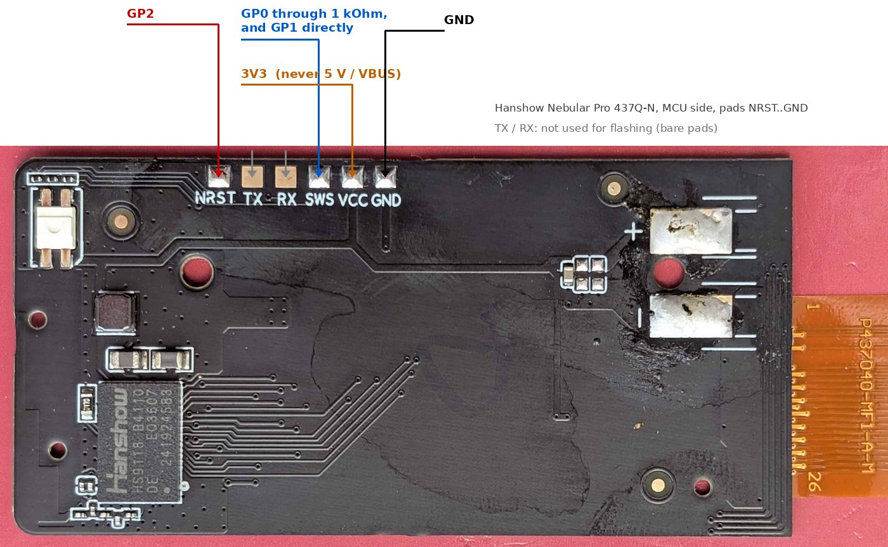

# Прошивка n437 0.9e: инструкция пользователя

Путь в репозитории: `steanlab/badge437` (публичный) → `docs/USER_GUIDE.ru.md`. English: `docs/USER_GUIDE.md`. Прошивка: `firmware/n437_0.9e.bin`. Страница: <https://steanlab.github.io/badge437/>.

Неофициальный проект. Прошивка заменяет оригинальную прошивку метки; делайте это, только если согласны с этим, на свой риск. Проверено на одной метке.

**Два этапа:** первая установка требует провод программатора (один раз, раздел 1); после этого всё, включая обновление прошивки (OTA), делается по Bluetooth со страницы. Оригинальную прошивку по Bluetooth обновить нельзя.

## 0. Что нужно

* **Метка:** Hanshow Nebular Pro 437Q-N (4,37", 176 x 480, четыре цвета). Маркировка `HSEL4Q_04_37M_32` есть на плате; другая модель Nebular имеет другую панель и другие выводы, эта прошивка только для 437Q-N.
* **Программатор** для однопроводного отладочного интерфейса Telink (SWS). Здесь это открытый **мост RP2040 от Gerard780** ([github.com/gerard780/hanshow-rp2040-programmer](https://github.com/gerard780/hanshow-rp2040-programmer), лицензия MIT): маленькая плата RP2040 с прошивкой моста **v1.6**, один **резистор 1 кОм** и пять коротких проводов.
  * Рекомендуемая плата: **Waveshare RP2040-Zero** с готовой прошивкой `dist/hanshow_pio_bridge.uf2` из того репозитория (SHA-256 `55a226a09190eaf8bae327b0671f9c1d1d261f7001a51e233e2f23a95c454a51`). Установка: зажмите кнопку BOOT, вставьте USB, скопируйте файл на диск `RPI-RP2`. Так прошивается **программатор**, а не метка.
  * Автор использовал **Raspberry Pi Pico** с тем же исходником, собранным с другими номерами GPIO (на его плате часть GPIO не работала). Вам это не нужно: сигналы те же, отличаются только номера GPIO.
* **Компьютер:** автор использовал **Ubuntu Linux с Python 3.12.3** (pyserial 3.5). Windows и macOS для этой метки не проверялись. В Ubuntu пользователю нужен доступ к последовательному порту: `sudo usermod -aG dialout $USER`, затем выйти и войти снова.
* **Провода к метке:** тонкие провода, припаянные к площадкам, или пружинные (pogo) щупы, прижатые к ним. Площадки маленькие и плоские.
* **Телефон или компьютер с Chrome или Edge** (Web Bluetooth) для страницы после прошивки: Android (есть и NFC), Windows, macOS, Linux, ChromeOS. **Не** iPhone / iPad, **не** Firefox / Safari.
* Около 30 минут в первый раз.

### Куда подключать провода

Площадки программирования расположены в один ряд на стороне платы с модулем MCU (`Hanshow HS9118`), у верхнего края, слева направо: `NRST  TX  RX  SWS  VCC  GND`. `TX` и `RX` для прошивки не нужны.



| RP2040-Zero (номера GPIO как напечатано на плате, не номера выводов Pico) | Площадка метки |
|---|---|
| `GP0`, **через резистор 1 кОм** | `SWS` |
| `GP1`, напрямую (со стороны метки от резистора) | `SWS` |
| `GP2` | `NRST` |
| `3V3` | `VCC` |
| `GND` | `GND` |
| `GP5` (UART RX), по желанию | `TX` (только чтобы читать лог метки; не обязательно) |

Это номера готового UF2. Если вы соберёте прошивку моста сами с другими GPIO, роли сохраняются: *выход SWS* через 1 кОм, *вход SWS* напрямую, *сброс* на `NRST`.

* **Пока паяете, USB отключён.** **3,3 В программатора питает метку**; батарея метки при прошивке **не подключена**. Никогда не питайте метку от батареи и от программатора одновременно и **никогда не подключайте 5 В / `VBUS` к `VCC`**.
* Не трогайте шлейф панели и его площадки.

## 1. Прошить (один раз)

1. **Сохраните оригинал.** Программа читает всю флеш-память метки до любой записи и сохраняет копию в файл. **Сохраните этот файл**: в нём заводские данные вашей панели (данные формы сигнала, нужные прошивке, см. [HARDWARE.md](HARDWARE.md)), калибровка радио и заводская запись вашей метки. Никогда не публикуйте его (в нём адрес вашей метки). Можно прочитать память дважды и сравнить копии.
2. Подключите провода по разделу 0, затем вставьте USB программатора в компьютер.
3. **Программа.** Прошиватель: [`tools/nebular_debug_custom.py`](../tools/nebular_debug_custom.py) Gerard780 (автора моста), включён без изменений, см. [`tools/README.md`](../tools/README.md). Он уже знает 437Q-N (идентификатор флеш-памяти `EB 60 13`, заводская запись по `0x7E000`, зона приложения `0x00000`..`0x1FFFF`), отказывается писать, если заводская запись не та, пишет только изменённые сектора зоны приложения и возвращает защиту флеш-памяти. Нужен Python 3.9 или новее; в Ubuntu (у автора Python 3.12.3):

   ```
   python3 -m venv .venv
   .venv/bin/pip install pyserial pyusb libusb-package
   ```

   Ниже вместо `python3` используйте `.venv/bin/python`, запуск из папки репозитория. При первом запуске скрипт скачивает четыре вспомогательных модуля из репозитория моста и проверяет их хеши (один раз нужен Интернет). Linux требует права на последовательные порты (`dialout`, раздел 0) и на USB; если доступ к USB запрещён, используйте правила udev проекта моста или запускайте команду через `sudo`. Закройте другие программы, работающие с последовательными портами. С одним мостом порты находятся сами; если мостов несколько, укажите `--bridge-serial`. Прошивка моста должна быть v1.4–v1.6 с включённым сбросом (готовый UF2 такой).
4. Программатор виден как последовательный USB-порт:

   ```
   python3 tools/nebular_debug_custom.py --model 437 --list-ports
   ```

   Мост должен быть в списке. Затем **пробный прогон** (только копия и план, ничего не пишется):

   ```
   python3 tools/nebular_debug_custom.py --model 437 --custom-firmware firmware/n437_0.9e.bin --no-questions --seconds 5
   ```

   Должно закончиться `plan_verified` без ошибок. Скрипт отказывается работать с меткой, у которой защита флеш-памяти не `2C` или заводская запись незнакома: тогда остановитесь и спросите.
5. **Прошивка:**

   ```
   python3 tools/nebular_debug_custom.py --model 437 --custom-firmware firmware/n437_0.9e.bin --apply --no-questions --seconds 5
   ```

   Должно закончиться `whole_flash_verified` и `protection_restored`. Пишется только зона приложения (первые 128 КиБ флеш-памяти), заводские данные не трогаются.
6. Отключите USB, снимите провода, подайте питание (вставьте батарею). Светодиод: красный, зелёный, синий, дважды. Первые 4 секунды прошивка стирает и форматирует свою область данных (это нормально; панель остаётся как была).
7. Проверьте файл до прошивки: `sha256sum -c SHA256SUMS.txt` в папке `firmware/`.

Если что-то выглядит неправильно, ничего не отправляйте в метку и сохраните копию; оригинальную прошивку можно записать обратно из копии с адреса `0x00000` тем же инструментом (не перезаписывайте `0x78000`..`0x7FFFF`).

**Первый запуск с мастером:** после подключения карточка «Первый запуск: пошаговая проверка» вверху страницы ведёт по шагам ниже (подключение, версия прошивки, ориентация, первая картинка, первая отрисовка, слайд-шоу) и отмечает каждый по ответам метки; «Скрыть мастер» прячет её (кнопка «Мастер первого запуска» возвращает).

## 2. Первое подключение (окно 120 секунд)

Метка стартует в **автономном режиме**: Bluetooth включён **только 120 с после подачи питания** (и 60 с после каждого касания, см. ниже). Короткая **синяя вспышка раз в 5 секунд** = «окно открыто, никто не подключён».

1. Откройте <https://steanlab.github.io/badge437/> в Chrome / Edge, нажмите «Подключиться» (кнопка языка переключает русский / английский), выберите устройство `OD-xxxx`.
2. После соединения светодиод даёт зелёную вспышку (потом слабая зелёная раз в 5 с). Карточка слотов показывает слоты и свободное место.
3. **Проверьте ориентацию:** карточка «Панель», ориентация = *зеркально по горизонтали* (значение по умолчанию в 0.9d). Если в метке сохранено другое (прошита 0.9a и ориентация не задавалась), картинки получаются зеркальными: выберите это значение и нажмите «Применить»; оно сохраняется. (Или команда `4D 02 17 27` в карточке для разработчиков.) Поле цветов (lut) оставьте `27`.
4. Когда окно кончается, светодиод один раз вспыхивает красным и метка засыпает. Чтобы открыть окно снова: коснитесь метки телефоном (NFC, 60 с) или отключите и верните питание (120 с).

## 3. Загрузить картинку

Карточка «Новая картинка»:

1. Выберите файл; он приводится к 176 x 480 (в предпросмотре вертикально; для горизонтальной картинки используйте поворот). Параметры: заполнить (обрезать) / целиком (белые поля) / растянуть, поворот, **растр** (Флойд–Стейнберг для фото, Аткинсон для рисунков и текста, упорядоченный, без растра), яркость и контраст, а также **цвета**: 4 (белый, чёрный, тёмно-красный, жёлтый) или 8 (добавляются оранжевый, охра и два серых; нужна прошивка 0.9d; картинка хранится как две плоскости, 20..40 КБ, поэтому их помещается меньше). Предпросмотр показывает идеальные цвета; сама панель бледнее и площе (чёрный тёмно-серый, тёмно-красный почти так же тёмен, как чёрный).
2. Выберите слот (0..23) и нажмите «Загрузить». Страница пробует три формата хранения и отправляет самый короткий. Индикатор показывает ход; держите страницу открытой и находитесь рядом с меткой.
3. Список слотов обновится; в нём **показать** (нарисовать слот сейчас, 20..25 с (два прохода), панель мигает при обновлении), **проверить** (прочитать и сверить CRC) и **стереть**. «Стереть все слоты» очищает всё.

Нарисованная картинка остаётся на панели без питания (электронная бумага). Панель показывает то, что нарисовано последним; живого предпросмотра нет.

## 4. Слайдшоу, касание, заставка, имя

**Карточка «Слайд-шоу»** на странице: отметьте «листать слайды сами», задайте интервал (от 1 минуты до 18 часов), **порядок** (по кругу или случайный; случайный нужен 0.9e), отметьте слайды, которые участвуют, при желании **чистку** панели каждые N слайдов (против «призраков»: «белый» или «чёрный, затем белый») и нажмите «Применить». «Прочитать» показывает, что хранит метка; «Следующий слайд сейчас» рисует следующий сразу. Интервал меньше 5 минут просит подтверждения (панель и батарея изнашиваются). Если следующий слайд уже на панели и не менялся (например, отмечен только один), метка его не перерисовывает.

**Касание** (коснуться метки телефоном, NFC) рисует следующий заполненный слот, даже если слайд-шоу выключено, и открывает окно связи на 60 с. Пустые слайды пропускаются. Где антенна NFC: петля идёт по краю платы; приложите заднюю сторону телефона к метке.

**Заставка при включении (0.9e).** После подачи питания или перезапуска (в том числе после обновления) метка рисует чёрную картинку с большими белыми буквами **BADGE437 PROJECT** и версией прошивки под ними (около 28 с). Если слайд-шоу включено, первый слайд появится через 2 минуты. Касание до отрисовки заставки отменяет её. Выключается галочкой в карточке «Режим работы».

Те же настройки командами (карточка «Для разработчиков», байты в hex; метка отвечает строкой `SS ...`):

| Команда | Смысл |
|---|---|
| `4A 01 3C 00 07 1E` | слайд-шоу **вкл**, интервал `3C 00` = 60 минут (16 бит, младший байт первым, 1..1080), слайды 0, 1, 2 (`07` = биты слотов 0..7; биты остальных слотов в дополнительных байтах, см. PROTOCOL.md), `1E` в автономном режиме не используется |
| `4A 00 3C 00 07 1E` | слайд-шоу выкл |
| `4A 01 3C 00 07 1E 05 02` | то же и очистка панели перед каждым 5-м слайдом (`02` = чёрный, затем белый; `01` = только белый) |
| `4F 08 01` / `4F 08 00` | случайный порядок / по кругу |
| `4F 09 01` / `4F 09 00` | заставка вкл / выкл |
| `4C` | нарисовать следующий слайд сейчас |
| `4B` | показать настройки слайд-шоу |
| `4E 41 42 43` | хвост имени: метка зовётся `OD-ABC` (1..5 символов; `4E` без символов = по умолчанию) |

## 5. Режимы работы

Карточка «Режим работы».

| | **Автономный** (по умолчанию) | **OpenDisplay** |
|---|---|---|
| Bluetooth | окно 120 с после питания, 60 с после касания (меняется, 10..250 с) | всегда на связи |
| Батарея | экономит: глубокий сон кусками до 250 с | расход больше (радио включено) |
| Для чего | смена картинок по таймеру и касанию, редкие изменения с телефона | Home Assistant, веб-инструмент OpenDisplay (opendisplay.org), частые изменения |

Смена режима перезапускает метку. Уснувшую автономную метку будят касанием телефона или выключением питания. В режиме OpenDisplay метка видна как `OD-xxxx` с сервисом OpenDisplay (UUID 0x2446); картинка от инструмента OpenDisplay попадает в слот, указанный в карточке «Панель» («слот для потока OpenDisplay», по умолчанию 23), и сразу рисуется; слот перезаписывается, храните картинки слайдшоу в других слотах. Инструмент OpenDisplay делает свои цвета.

## 6. Сигналы светодиода

| Сигнал | Смысл |
|---|---|
| красный, зелёный, синий, дважды | подача питания |
| слабая синяя вспышка раз в 5 с | автономное окно открыто, никто не подключён |
| зелёная вспышка (60 мс) | соединение установлено; дальше слабая зелёная раз в 5 с |
| синяя вспышка каждую секунду | идёт загрузка |
| жёлтый | смена слайда (касание или таймер) |
| зелёный дважды | команда выполнена |
| красный трижды | ошибка |
| красный пять раз | низкий заряд (пока не работает: батарея не измеряется) |
| красная вспышка (80 мс) | окно кончилось, метка засыпает |

`4F 04 01` оставляет только включение, ошибки и низкий заряд; `4F 04 02` по умолчанию (все события).

## 7. Обновление прошивки по Bluetooth (OTA)

Нужна уже работающая 0.8 или новее; **откат** работает с 0.9 (переход 0.8 → 0.9 не защищён). Нужен файл `n437_x.y.bin` из релиза этого репозитория (проверьте SHA-256).

1. Подключитесь (в окне), откройте «Обновление прошивки по Bluetooth (OTA)», выберите файл. Страница проверяет его (заголовок, длина, строка `N437 fw 437-`) и показывает версию файла, текущую версию и образ (`img=A` или `B`).
2. «Загрузить в метку»: около 100 КБ примерно за 16 с в **свободную** область образа; работающая прошивка не трогается. Метка отвечает `OTA STAGED 437-x.y` после проверки CRC, чтения обратно и заголовка. Если связь оборвалась, ничего не изменилось.
3. «Переключиться на новую»: метка через несколько секунд перезапускается и запускает новый образ **на пробу**; подключитесь снова через 10 с (окно откроется заново).
4. Новый образ **подтверждается** после 5 с работы или при уходе в сон. Если он работает неправильно (зависает, падает, перезапускается), метка перезапускает его до трёх раз и затем **сама возвращает прежнюю прошивку**; это около минуты, метка молчит. После этого страница показывает «откат» (`tr=2`), работает прежняя версия. Если метка молчит больше 3 минут: отключите и верните питание; если всё ещё мертва, прошейте программатором.
5. Данные (картинки, настройки, имя) при обновлении сохраняются, если в заметках к релизу не сказано, что раскладка памяти изменилась.

Пока идёт проба (первые секунды после переключения), загрузка запрещена.

## 8. Если что-то не так

| Симптом | Что делать |
|---|---|
| Метки нет в списке | Окно закрыто (нет синей вспышки раз в 5 с). Коснитесь метки телефоном или отключите и верните питание. Метка должна быть в нескольких метрах |
| В журнале «Web Bluetooth недоступен в этом браузере» | используйте Chrome или Edge, не Firefox / Safari / iOS |
| Картинка зеркальная | задайте ориентацию (раздел 2, шаг 3) |
| Цвета бледные / плоские | нормально: чёрный панели около 4,5 : 1 к её белому, тёмно-красный почти так же тёмен, как чёрный; полутона получаются светлее оригинала. Панель лучше смотреть при дневном свете; попробуйте Аткинсона или чуть больший контраст |
| На панели тень прежней картинки | очистка (`4A ... 01 02`) или нарисуйте дважды |
| «нет места» при загрузке | свободные сектора не подряд; сотрите слот (`40` в карточке для разработчиков показывает занятые слоты, свободные сектора и наибольший свободный кусок) |
| Связь рвётся при обновлении панели | на некоторых телефонах нормально; подключитесь снова. Инструмент OpenDisplay переподключается сам |
| После прошивки ничего | проверьте, что пробный прогон закончился `plan_verified`, а прошивка `whole_flash_verified`; проверьте провода; выключите и включите питание; при необходимости восстановите копию |
| Метка перезапускается каждые 15 с | срабатывает сторожевой таймер: пришлите полный журнал страницы («Сохранить в файл») |

Журнал внизу страницы можно скопировать или сохранить; прикладывайте его к каждому отчёту об ошибке (в нём нет личных данных, кроме имени метки).

## 9. Ограничения

* **Нет аутентификации**: пока окно открыто (в режиме OpenDisplay всегда) любой в зоне радио может подключиться и менять картинки, настройки и прошивку. Держите окна короткими; для меток в общественных местах используйте автономный режим.
* **Батарея**: штатный элемент метки, вероятно, неперезаряжаемый литиевый (маркировка `CF332544 750mAh 3.0V`); **никогда не заряжайте его**. Прошивка пока не измеряет батарею, оценок времени работы нет.
* Первый запуск после прошивки стирает область данных; слоты старых версий пропадают.
* Эту прошивку пока запускали на **одной метке**. Присылайте, что видите, особенно результаты на другой метке.
